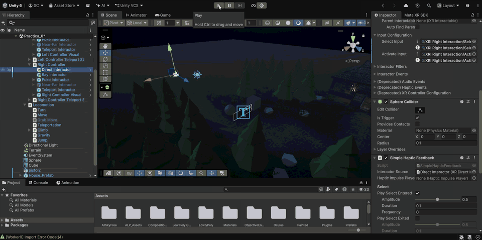
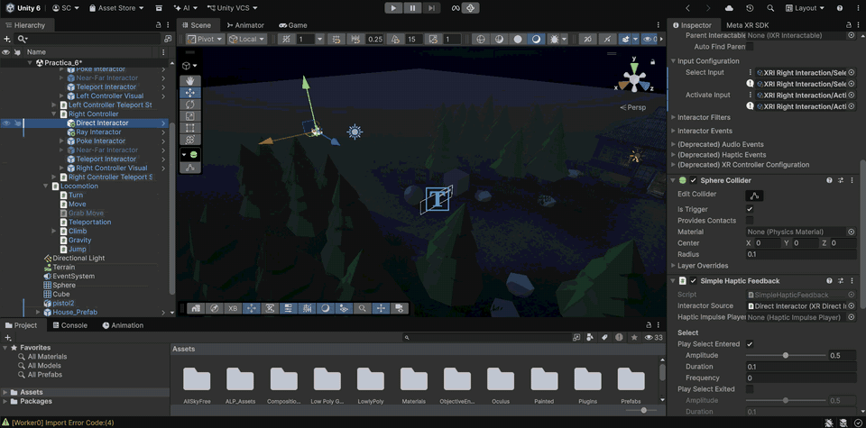

# Práctica 6 - Interacción en Realidad Virtual con XR Interaction Toolkit

Esta práctica de la asignatura **Interfaces Inteligentes** se centra en la interacción en realidad virtual mediante el **XR Interaction Toolkit** de Unity. El toolkit separa la interacción en tres piezas: los **interactuadores** (*Interactors*), que son las manos o mandos del jugador y detectan los objetos con los que se puede interactuar; los **interactuables** (*Interactables*), que son los objetos de la escena que se pueden seleccionar o agarrar; y el **Interaction Manager**, que gestiona los eventos entre ambos. Sobre esta base se utilizan un **Ray Interactor**, que detecta objetos a distancia mediante un rayo, y un **Direct Interactor**, que detecta objetos por contacto mediante un collider. Todo el funcionamiento se prueba con el **simulador genérico del XR Interaction Toolkit**, sin necesidad de gafas.

---

## Configuración del proyecto

Se han instalado desde el *Package Manager* los siguientes paquetes:

| Paquete                       | Uso                                                                 |
|-------------------------------|---------------------------------------------------------------------|
| `XR Plugin Management`        | Gestiona qué plugin XR se carga en cada plataforma                  |
| `OpenXR Plugin`               | Estándar de XR utilizado como plugin                                |
| `XR Interaction Toolkit`      | Sistema de interactuadores, interactuables y eventos                |
| `Input System`                | Sistema de entrada que usa el toolkit para leer los mandos          |

Desde la pestaña *Samples* del XR Interaction Toolkit se han importado:

- **Starter Assets**: contiene el `XR Origin (XR Rig)`, los prefabs de los interactuadores y el asset de acciones `XRI Default Input Actions`.
- **XR Interaction Simulator**: simulador genérico que permite controlar la cabeza y los mandos con el teclado y el ratón.

En *Project Settings > XR Plug-in Management* se ha activado **OpenXR** en la pestaña de Windows y, dentro de *OpenXR*, se han añadido los perfiles de interacción **Oculus Touch Controller Profile** y **Meta Quest Touch Plus Controller Profile**. El simulador está configurado en *XR Interaction Toolkit > Use XR Interaction Simulator in scenes* para que se instancie automáticamente al entrar en modo Play dentro del editor, por lo que no es necesario añadirlo a la escena.

## Configuración de la escena

### XR Origin

1. Se elimina la `Main Camera` de la escena, ya que el rig trae su propia cámara que sigue la cabeza. Con dos cámaras la vista podría salir mal.
2. Se añade el prefab **`XR Origin (XR Rig)`** de los *Starter Assets*. Es el cuerpo del jugador: define el suelo, la cámara (cabeza) y los dos mandos. Ya incluye la locomoción (`Locomotion Mediator`, movimiento continuo y `Teleportation Provider`).

### Interactuadores: Ray Interactor y Direct Interactor

En la versión por defecto del toolkit, cada mando del `XR Origin` trae un único **Near-Far Interactor**, que combina la interacción cercana y lejana en un solo componente. Para trabajar con los interactuadores vistos en teoría y que cada objeto responda solo al que le corresponde, se ha sustituido en el mando derecho por un Ray Interactor y un Direct Interactor:

1. Se desactiva el GameObject **`Near-Far Interactor`** de `Left Controller` y de `Right Controller`.
2. Se añaden como hijos de `Right Controller` los prefabs **`Ray Interactor`** y **`Direct Interactor`** de *Starter Assets/Prefabs/Interactors*, con su `Transform` a (0, 0, 0) para que salgan de la posición del mando, y con **Handedness** en `Right`.
3. Como estos prefabs vienen sin botones asignados, en *Input Configuration* de cada uno se asignan las acciones de `XRI Default Input Actions`:

| Campo              | Acción                                                    | Interactuador  |
|--------------------|-----------------------------------------------------------|----------------|
| Select Input       | `XRI Right Interaction/Select` y `Select Value`           | Ray y Direct   |
| Activate Input     | `XRI Right Interaction/Activate` y `Activate Value`       | Ray y Direct   |
| UI Press Input     | `XRI Right Interaction/UI Press` y `UI Press Value`       | Ray            |

4. En el componente **`Controller Input Action Manager`** de cada mando se deja el campo *Near-Far Interactor* en `None` y, en el mando derecho, se asigna el nuevo Ray Interactor en el campo *Ray Interactor*. Si no, este script vuelve a activar el Near-Far Interactor al terminar un teletransporte.
5. En el **`XR Interaction Group`** del mando derecho se sustituye el Near-Far Interactor por el Direct Interactor y el Ray Interactor en *Starting Group Members*.

Ajustes de cada interactuador:

- **Ray Interactor**: *Max Raycast Distance* a **30**, ya que el valor por defecto (10 m) no alcanza los objetos más lejanos. En su `XR Interactor Line Visual` se aumenta el grosor de la línea (*Line Width* a 0.02) y se desactiva *Auto Adjust Line Length* para que el rayo sea visible en todo momento. La línea cambia de color al apuntar a un objeto interactuable.
- **Direct Interactor**: detecta los objetos con un `Sphere Collider` marcado como *Is Trigger*. Su *Radius* define a qué distancia de la mano se puede coger un objeto.

### Interaction Layers

Para que el cubo y la esfera solo respondan al rayo y el objeto de la Asset Store solo a la mano, se usa la **Interaction Layer Mask**, que define qué capas incluye o excluye cada interactuador. Se crean dos capas, `Rayo` y `Directo`, y se asignan así:

| Objeto                                 | Componente             | Interaction Layer Mask |
|----------------------------------------|------------------------|------------------------|
| `Right Controller > Ray Interactor`    | XR Ray Interactor      | `Rayo`                 |
| `Right Controller > Direct Interactor` | XR Direct Interactor   | `Directo`              |
| Cubo                                   | XR Grab Interactable   | `Rayo`                 |
| Esfera                                 | XR Grab Interactable   | `Rayo`                 |
| Pistola (Asset Store)                  | XR Grab Interactable   | `Directo`              |

Un interactuador solo puede seleccionar un interactuable si ambos comparten al menos una capa. De este modo, aunque la mano toque el cubo o el rayo apunte a la pistola, la interacción no se produce.

### Interactuables

Los tres objetos tienen los componentes necesarios para ser interactuables:

| Componente             | Qué aporta                                                       |
|------------------------|------------------------------------------------------------------|
| `Collider`             | Permite que los interactuadores lo detecten (*Is Trigger* a falso) |
| `Rigidbody`            | Física: el objeto cae, rebota y se puede lanzar al soltarlo       |
| `XR Grab Interactable` | Lo marca como agarrable y define cómo se comporta al cogerlo      |

### Interfaz de usuario

Para mostrar mensajes dentro de la realidad virtual se utiliza un `Canvas` en modo **World Space**, colocado flotando delante del jugador, con un texto de TextMeshPro. En el `EventSystem` se sustituye el *Input System UI Input Module* por el **XR UI Input Module**, que es el que permite a los interactuadores trabajar con la interfaz.

---

## Ejercicio

> Agrega en la escena un cubo, una esfera y un objeto de la asset store que elijas sobre un plano, cada uno de ellos a diferentes distancias. El cubo y esfera serán Ray Interactor que cambian de color al seleccionarlo. El objeto de la asset store será un Direct Interactor que actualiza la UI al agarrarlo.

Los objetos se colocan sobre el terreno de la escena a diferentes distancias del punto de inicio del jugador: la **pistola** (objeto de la Asset Store, del paquete *Low Poly Guns*) justo delante, al alcance de la mano; la **esfera** a unos 16 metros; y el **cubo** a unos 20 metros, de modo que solo se pueden alcanzar con el rayo.

En los dos scripts la acción no se programa detectando la interacción por código, sino a través de los **eventos predefinidos** del `XR Grab Interactable` (*Interactable Events*). Siguiendo el esquema general de la interacción, el interactuador detecta el objeto (el rayo lo intersecta o la mano lo toca), el usuario pulsa el botón del mando y el interactuable recibe un evento que desencadena la acción. Los scripts solo contienen métodos públicos, que se enlazan a esos eventos desde el Inspector arrastrando el propio objeto y seleccionando el método.

### Cubo y esfera: Ray Interactor que cambia de color

El script **`xr_cambiar_color.cs`** se añade al cubo y a la esfera:

- En `Start()` guarda la referencia a su `Renderer` con `GetComponent<Renderer>()`.
- El método público `cambiar_color()` muestra por consola el objeto seleccionado y asigna al material un color aleatorio con `Random.ColorHSV()`, igual que en las prácticas de colisiones.
- En el `XR Grab Interactable` de cada objeto, el evento **Select Entered** llama a `cambiar_color()`. Así, cada vez que el rayo selecciona el objeto, este cambia de color.

Como los dos objetos están en la capa `Rayo`, solo el Ray Interactor puede seleccionarlos.

Script: [Assets/Scripts/Practica6/xr_cambiar_color.cs](Assets/Scripts/Practica6/xr_cambiar_color.cs)

### Objeto de la Asset Store: Direct Interactor que actualiza la UI

El script **`xr_actualizar_ui_agarre.cs`** se añade a la pistola:

- Recibe desde el Inspector la referencia al texto de la interfaz (`TMP_Text`) y el nombre del objeto que se mostrará en los mensajes.
- En `Start()` muestra el mensaje inicial `"Busca la pistola"`.
- El método `al_agarrar()` incrementa el contador `veces_agarrado` y muestra `"Has cogido la pistola"` junto con el número de veces que se ha cogido.
- El método `al_soltar()` muestra `"Has soltado la pistola"`.
- Ambos utilizan la función privada `mostrar_mensaje()`, que escribe el mensaje en la consola con `Debug.Log()` y lo asigna al texto de la UI. Si no hay ningún texto asignado, solo lo muestra por consola.
- En el `XR Grab Interactable` de la pistola, el evento **Select Entered** llama a `al_agarrar()` y el evento **Select Exited** llama a `al_soltar()`.

Como la pistola está en la capa `Directo`, solo se puede coger con el Direct Interactor, es decir, acercando la mano hasta tocarla.

Script: [Assets/Scripts/Practica6/xr_actualizar_ui_agarre.cs](Assets/Scripts/Practica6/xr_actualizar_ui_agarre.cs)

**Autores:** 
1. Javier Acosta Portocarrero (alu0101660769@ull.edu.es)
2. Adrián Pérez Poleo (alu0101635224@ull.edu.es)
3. Sergio Rosales Calzadilla (alu0101635590@ull.edu.es)